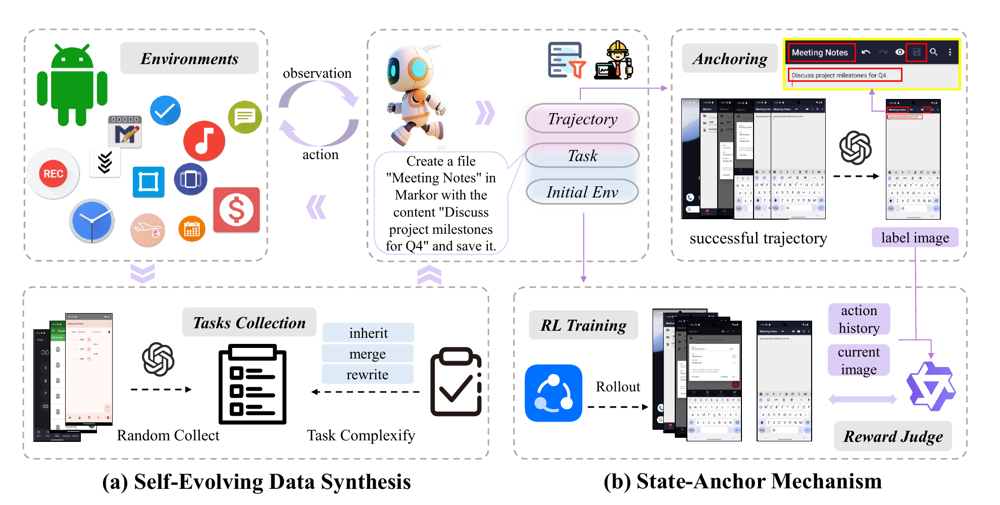

# GSAR

> Goal-State-Anchor Rewards for Mobile GUI Agents with Self-Evolving Data Synthesis

[Paper](https://arxiv.org/abs/2608.22847) · [License](LICENSE) · [Issues](https://github.com/lossooo/GSAR/issues)

GSAR is a framework for generating mobile GUI interaction data and evaluating trajectory completion with goal-state anchors. It combines two parts:

1. **Self-evolving data synthesis** repeatedly explores apps, generates tasks, executes them, and carries collected environment states into later iterations.
2. **Goal-State-Anchor Reward** marks task-relevant UI elements in a successful goal state and compares that reference with the current screen to judge task completion.

See the [paper](https://arxiv.org/abs/2608.22847) for the method, datasets, experiments, and online RL setup.

<p align="center">
  
</p>

## Installation

GSAR supports Python 3.10–3.12. We recommend a fresh Python 3.11 environment.

```bash
git clone https://github.com/lossooo/GSAR.git
cd GSAR
python -m venv .venv
source .venv/bin/activate
python -m pip install --upgrade pip
python -m pip install -e ".[all]"
```

## Model configuration

All model calls use an OpenAI-compatible API. Set the credentials in your shell:

```bash
export GSAR_API_KEY="your-api-key"
export GSAR_BASE_URL="https://api.openai.com/v1"
export GSAR_MODEL="gpt-4o"
```

The project does not automatically load `.env`; export these variables in your shell.

## Quick start

### Data synthesis

Connect a rooted Android emulator or device and check that `adb` can see it:

```bash
adb devices
```

Set the package list and collection limits in `configs/data_synthesis.yaml`, then run:

```bash
bash scripts/data_synthesis/run_synthesis.sh
```

Collected trajectories and logs are saved under `data/datasets/data_synthesis/` and `data/logs/synthesis/` by default.

### Reward evaluation

Set the input and output paths in `configs/verification.yaml`, then run:

```bash
gsar-anchor
gsar-verify --method goalstate --stage both
```

The available methods are `digirl`, `distrl`, `stepcritic`, `goalstate`, and `stepgoal`.

Generated data, screenshots, APKs, emulator copies, model outputs, and credentials are excluded by `.gitignore`. The JSON files under `examples/` document the expected formats.

## Citation

```bibtex
@inproceedings{zhang-etal-2026-gsar,
  title = "{GSAR}: Goal-State-Anchor Rewards for Mobile {GUI} Agents with Self-Evolving Data Synthesis",
  author = "Zhang, Long  and
    Chen, Yuhan  and
    Zhang, Chaoran  and
    Cao, Wanxia  and
    Huang, Kun  and
    Gao, Pengzhi  and
    Liu, Wei  and
    Luan, Jian  and
    Li, Chenliang  and
    Zou, Lixin",
  editor = "Lee, Hung-Yi  and
    Dev, Sunipa  and
    Li, Jessy  and
    Elliott, Desmond",
  booktitle = "Proceedings of the 2026 Conference on Empirical Methods in Natural Language Processing",
  month = oct,
  year = "2026",
  address = "Budapest, Hungary",
  publisher = "Association for Computational Linguistics",
  url = "https://aclanthology.org/2026.emnlp-main.2095/",
  pages = "47714--47730",
  ISBN = "979-8-89176-459-0"
}
```

## License

Released under the [MIT License](LICENSE).
